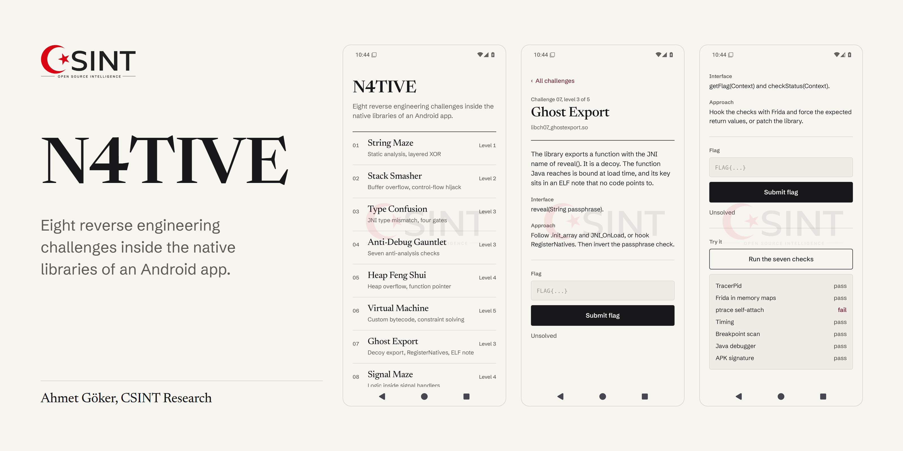

<p align="center">
  <picture>
    <source media="(prefers-color-scheme: dark)" srcset="docs/banner-dark.png">
    
  </picture>
</p>

# N4TIVE

Eight reverse engineering challenges inside the native libraries of an Android app.

Each challenge is a small C library with one job, which is to keep a flag away from you. You get the flag by working out what the compiled code does, with a disassembler, with Frida, or with both. The app checks the flag you submit and remembers which challenges you have solved.

## The challenges

| No | Challenge | Level | What you face |
|---|---|:---:|---|
| 01 | String Maze | 1 | A flag under three layers of encryption |
| 02 | Stack Smasher | 2 | A 64-byte stack buffer with a function pointer behind it |
| 03 | Type Confusion | 3 | Four gates that open for input they were not built for |
| 04 | Anti-Debug Gauntlet | 3 | Seven anti-analysis checks, each one a key byte |
| 05 | Heap Feng Shui | 4 | A slab allocator that writes 16 bytes too far |
| 06 | Virtual Machine | 5 | A custom stack machine and its encoded program |
| 07 | Ghost Export | 3 | A decoy export, a hidden registration and a key in an ELF note |
| 08 | Signal Maze | 4 | A check that runs inside signal handlers |

Levels run from 1 to 5. Each challenge lives in its own library, named in the notes below.

## How to play

1. Build the app and install it on a device or an emulator.
2. Take the libraries out of the APK and open them in Ghidra or IDA.
3. Recover a flag. Every flag has the form `FLAG{...}` with a lowercase hexadecimal body.
4. Submit it in the app, or check it offline with the script below.

You will want a disassembler, Frida for the challenges that need a hook or a crafted call, and some familiarity with ARM or x86 assembly and with JNI.

The sources in `app/src/main/jni` describe every challenge in their comments, down to the way it is solved. Read them afterwards if you want the challenge to stay one.

## Notes on each challenge

<details>
<summary>01 String Maze</summary>

Library `libch01_stringmaze.so`.

Static analysis and layered XOR. The flag sits in the library under three layers, a rolling XOR, a byte permutation and a second XOR whose key is scattered over `.rodata`. Reverse the chain. `solve()` returns the first characters as a hint.
</details>

<details>
<summary>02 Stack Smasher</summary>

Library `libch02_stacksmasher.so`.

Buffer overflow and control-flow hijack. `processInput()` copies its argument into a 64-byte stack buffer without a length check, and a function pointer sits directly behind that buffer. Overwrite the pointer so the call lands in the hidden `compute_secret()`. The seed it writes to logcat is the body of the flag.
</details>

<details>
<summary>03 Type Confusion</summary>

Library `libch03_typeconfusion.so`.

Loosely typed JNI arguments. Four gates guard four key fragments. Two of them open for an object of the wrong type, one for a value that changes between two reads, and one for a payload with the right checksum. `combine()` joins the fragments once all four gates are open.
</details>

<details>
<summary>04 Anti-Debug Gauntlet</summary>

Library `libch04_gauntlet.so`.

Seven anti-analysis checks stand in front of the flag, and each one contributes a key byte.

1. TracerPid in `/proc/self/status`
2. Frida in the memory maps
3. A ptrace self-attach
4. Timing
5. A scan for breakpoint instructions
6. The Java debugger
7. The APK signature

All seven have to pass or be bypassed. The app can run them and show the result of each. On the Android 15 emulator used for testing, the ptrace check fails by itself, because SELinux denies the self-attach. There that one has to be bypassed.
</details>

<details>
<summary>05 Heap Feng Shui</summary>

Library `libch05_heapcraft.so`.

Heap overflow and a function pointer. A slab allocator holds eight slots. `edit()` writes 16 bytes past the data field of a slot, far enough to reach its read handler. Redirect the handler to the hidden `flag_generator()`.
</details>

<details>
<summary>06 Virtual Machine</summary>

Library `libch06_vm.so`.

A stack-based virtual machine with 32 instructions runs a program that is XOR-encoded in the binary. The program takes 16 bytes, transforms them and compares the result with constants. Recover the instruction set, decode and disassemble the program, then solve the constraints. Exactly one input passes, and the flag is derived from it, so the library does not store the flag.
</details>

<details>
<summary>07 Ghost Export</summary>

Library `libch07_ghostexport.so`.

The library exports a function with the JNI name of `reveal()`. That export is a decoy and answers with a flag the verifier rejects. The function Java reaches is bound in `JNI_OnLoad` through `RegisterNatives`. A constructor in `.init_array` runs first, finds a custom ELF note in the library's own program headers and takes a key from it. Find the hidden function, read the key with `readelf -n`, and invert the passphrase check.
</details>

<details>
<summary>08 Signal Maze</summary>

Library `libch08_signalmaze.so`.

`walk()` takes a 16-character code and raises `SIGTRAP` once per character. The work happens in three signal handlers. Each one mixes the current byte into a 64-bit state, compares part of it with a checkpoint and installs the handler for the next step, so the order of the handlers depends on the code. Find the handlers through `sigaction`, rebuild the walk offline and recover the code one character at a time. A debugger that swallows the signal ends the walk.
</details>

## Build and install

There is no prebuilt APK. The app is built from source.

You need JDK 17 or newer and the Android SDK with platform 34, the NDK and CMake 3.22.1. The last two install from the SDK Manager in Android Studio. The Gradle wrapper fetches Gradle 8.5 by itself.

```
git clone https://github.com/0xCD4/N4TIVE.git
cd N4TIVE
./gradlew assembleDebug
adb install app/build/outputs/apk/debug/app-debug.apk
```

The app runs on Android 8.0 and newer, on a device or an emulator. A debug build compiles the libraries with `-O0 -g`, a release build with `-O2`. The release build is the harder one to read.

## Check a flag offline

```
./scripts/verify_flag.sh ch01 "FLAG{...}"
```

The script needs bash 4 or later and openssl. It holds the same salts and HMAC-SHA256 digests as `flag_core.c`, so it accepts exactly the flags the app accepts. The digests cannot be turned back into flags.

## What was tested

Every challenge was solved through its intended path with the real C code on a Linux host, also under AddressSanitizer and UndefinedBehaviorSanitizer. The eight libraries compile without warnings for arm64-v8a, armeabi-v7a, x86_64 and x86, as debug and as release builds.

The app was then run on an Android 15 x86_64 emulator. Seven challenges were solved inside the app process there. Challenge 04 needs its ptrace check bypassed on that Android version, as described above.

It has not been tested on ARM hardware, and the release build has not been run on a device.

## Maintaining the flags

One script writes the encrypted tables in the challenge sources and the digests in `flag_core.c` and `scripts/verify_flag.sh`. It reads the flags from one secret file, so a table and its digest cannot drift apart.

```
python scripts/gen_flags.py new      # create FLAGS_SECRET.txt with random flags
python scripts/gen_flags.py extend   # add entries for new challenges, keep the others
python scripts/gen_flags.py apply    # rewrite the generated blocks
python scripts/gen_flags.py check    # fail if the sources and the secrets differ
```

`FLAGS_SECRET.txt` is ignored by git and has to stay private. The blocks between the `gen_flags begin` and `gen_flags end` markers are not edited by hand.

## Project layout

```
app/src/main/
├── assets/fonts/        Newsreader and Schibsted Grotesk
├── java/com/ctf/nativectf/
│   ├── MainActivity.java       the list of challenges
│   ├── ChallengeActivity.java  one challenge and its flag field
│   ├── Challenges.java         titles, levels and descriptions
│   ├── Progress.java           which challenges are solved
│   ├── Ui.java                 palette, typefaces, buttons
│   └── challenges/             Ch01.java to Ch08.java, the JNI declarations
└── jni/
    ├── flag_core.c             SHA-256, HMAC and flag verification
    └── ch01_stringmaze.c to ch08_signalmaze.c

docs/        the images of this page
licenses/    licence texts of the bundled typefaces
scripts/     gen_flags.py and verify_flag.sh
```

## Typefaces

The app sets its headings in Newsreader and its text in Schibsted Grotesk. Both are bundled as Latin subsets and are licensed under the SIL Open Font License 1.1. The licence texts are in `licenses/`.

## License

N4TIVE, Copyright (c) 2026 Ahmet Göker, is licensed under the Creative Commons Attribution-NonCommercial 4.0 International License (CC BY-NC 4.0). The full text is in `LICENSE`.

You may use, change and share the project for non-commercial purposes, provided you give credit. Credit means naming Ahmet Göker as the author and linking to this repository. Commercial use, such as paid training, needs written permission from the author.

Two parts come from others and keep their own terms. The bundled typefaces are under the SIL Open Font License 1.1, see `licenses/`. The Gradle wrapper files are under the Apache License 2.0.

## Author

Ahmet Göker, [CSINT Research](https://csintresearch.org)
